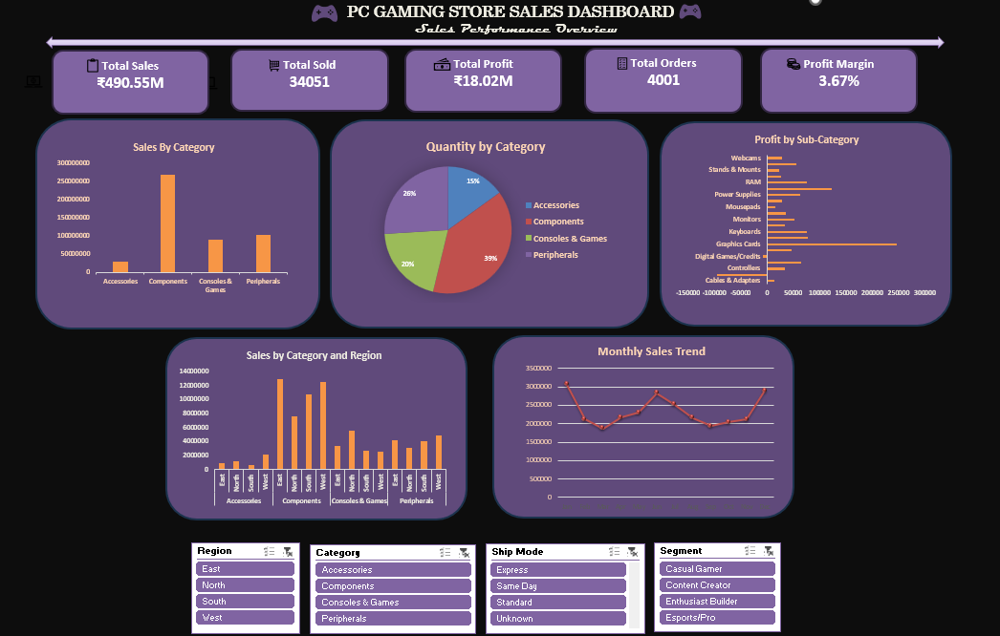

# 🎮 PC Gaming Store Sales Analysis

<p align="center">
  <strong>Turning Sales Data into Meaningful Business Insights with Microsoft Excel</strong>
</p>

---

## 📌 About the Project

The **PC Gaming Store Sales Analysis** project focuses on analyzing sales transactions from a PC gaming store using Microsoft Excel. It explores sales performance, profitability, product categories, and customer purchasing patterns to demonstrate how raw data can be transformed into useful business information.

The project combines Excel formulas, data analysis, KPI calculations, PivotTables, and charts to organize information and communicate findings in a clear and structured way.

## 🎯 Business Objectives

- 📈 **Sales Performance:** Analyze sales results and understand overall performance.
- 💰 **Profitability Analysis:** Examine profit trends and financial performance.
- 🖥️ **Product Analysis:** Compare performance across product categories.
- 👥 **Customer Insights:** Explore customer purchasing patterns and segments.
- 📊 **KPI Monitoring:** Summarize important metrics for quick decision-making.
- 📉 **Visual Reporting:** Present analytical results through charts and a dashboard.

## 🛠️ Tools & Techniques

| Tool / Technique | Purpose |
|---|---|
| Microsoft Excel | Main data analysis tool |
| Excel Formulas & Functions | Calculate metrics and derive insights |
| Data Cleaning | Improve data consistency and usability |
| PivotTables | Summarize and compare sales data |
| PivotCharts | Visualize patterns and comparisons |
| KPI Analysis | Track important performance metrics |
| Dashboard Design | Present key information in one place |

## 📊 Dashboard Preview


<p align="center">
  <em>PC Gaming Store Sales Dashboard.</em>
</p>

## 🔍 Analysis Areas

### 1. Sales & Profit Analysis
Examine sales and profit measures to understand business performance.

### 2. Product Category Analysis
Compare categories to identify differences in sales contribution and profitability.

### 3. Customer Analysis
Explore customer-related metrics and purchasing patterns represented in the dataset.

### 4. KPI Reporting
Use calculated metrics to provide a concise overview of selected business indicators.

### 5. Visual Analysis
Use charts and dashboard elements to communicate information more effectively than raw tables alone.

## 📁 Repository Structure

```text
pc-gaming-store-sales-analysis/
│
├── PC-Gaming-Store-Sales-Analysis.xlsx
├── dashboard-preview.png
└── README.md
```

*Note: `dashboard-preview.png` is optional. Add it after capturing and uploading your actual dashboard screenshot.*

## 🚀 Getting Started

You can explore this project in a few simple steps:

1. Open the Excel workbook in this repository.
2. Download the file using GitHub's download option.
3. Open it in Microsoft Excel.
4. Explore the data analysis and KPI sheets.
5. Review the PivotCharts and dashboard.
6. Interact with available filters or slicers, where supported.

## 💡 Skills Demonstrated

- Data organization and cleaning
- Excel formulas and functions
- Data aggregation and summarization
- PivotTables and PivotCharts
- KPI calculation
- Business-oriented data analysis
- Dashboard reporting and visualization

## 📚 Key Learnings

This project provided practical experience in structuring sales data, calculating business metrics, comparing product categories, and presenting analytical results through Excel visualizations.

It also demonstrates the importance of checking data quality and validating calculations before drawing business conclusions.

## 🗂️ Dataset Information

The dataset is intended for learning and portfolio demonstration. It should not be interpreted as verified sales records from a real business.

Analytical conclusions are dependent on the quality and consistency of the underlying data.

## 👨‍💻 About the Author

**Aspiring Data Analyst**

Currently developing practical skills in:

- Microsoft Excel
- SQL
- Power BI
- Python
- Exploratory Data Analysis

This repository is part of my journey toward building practical data analytics projects and developing a professional portfolio.

---

<p align="center">
  <strong>📊 Learning by analyzing. Growing by building.</strong>
</p>
